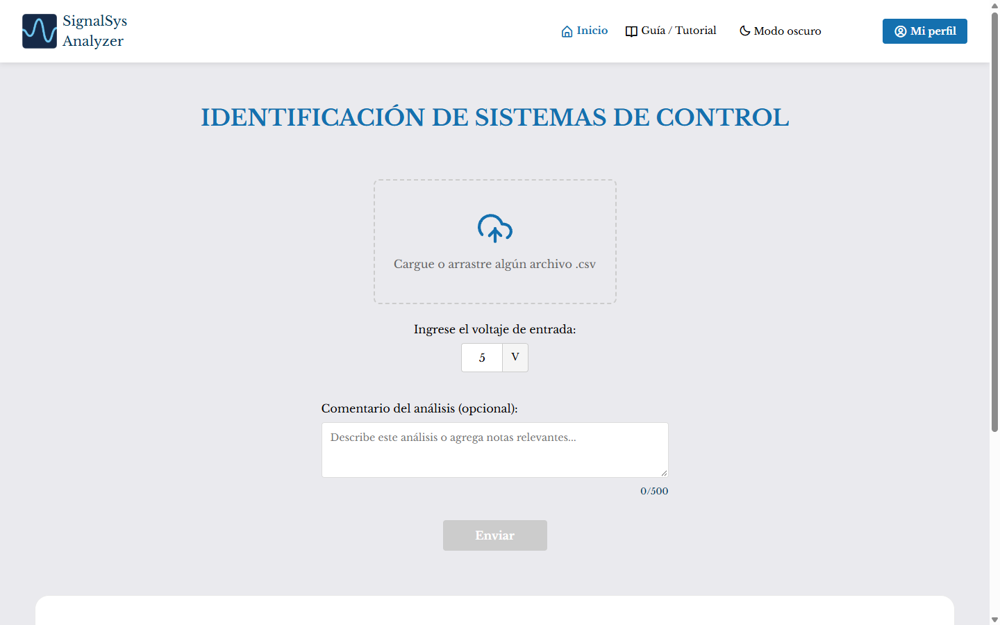
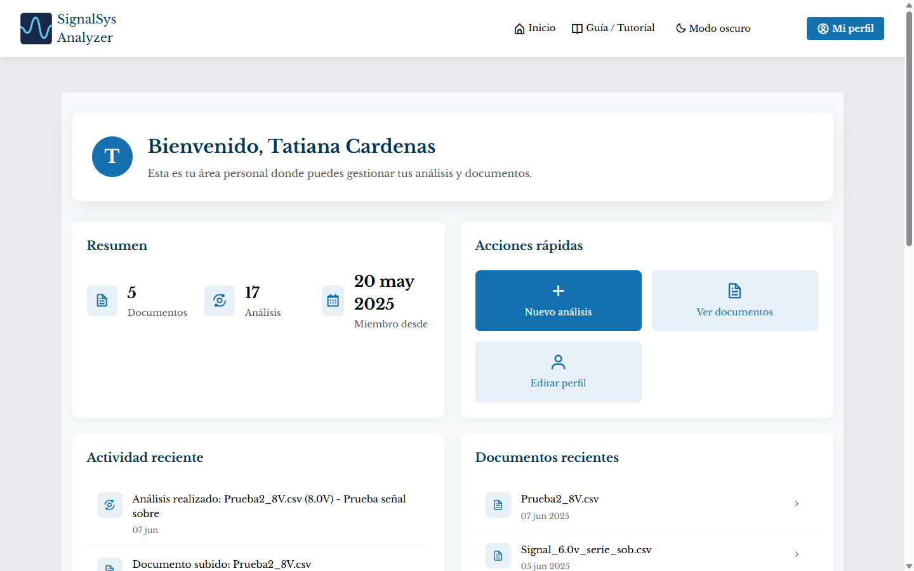
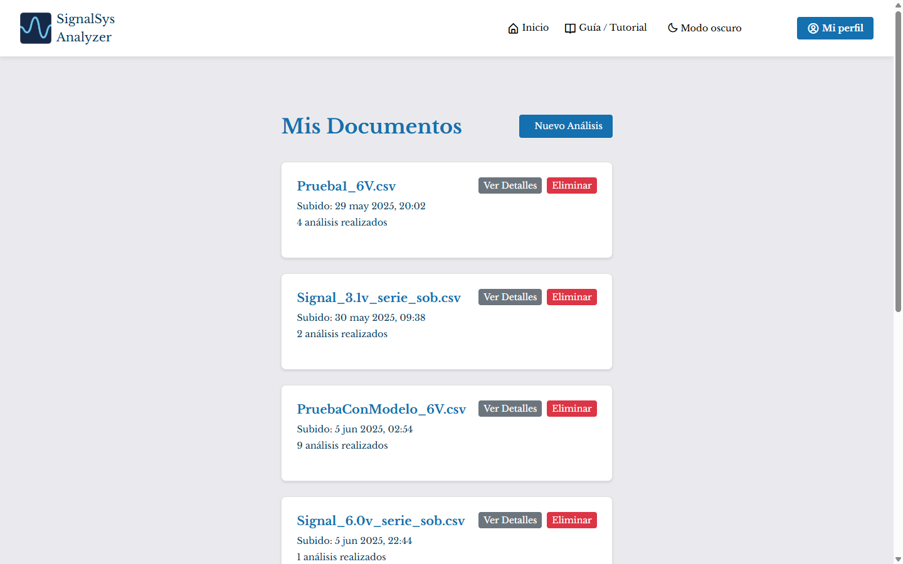
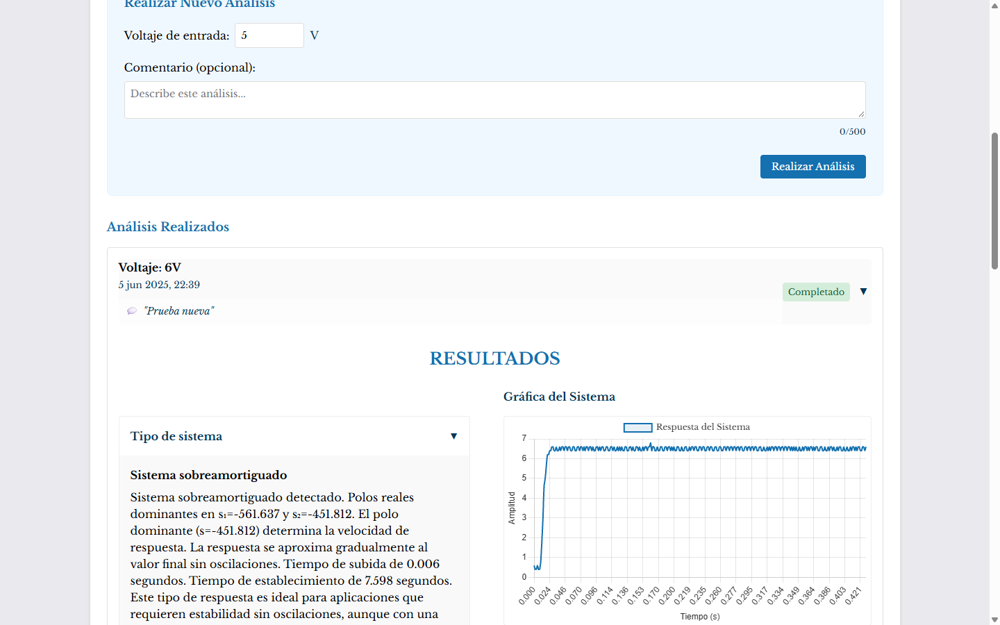
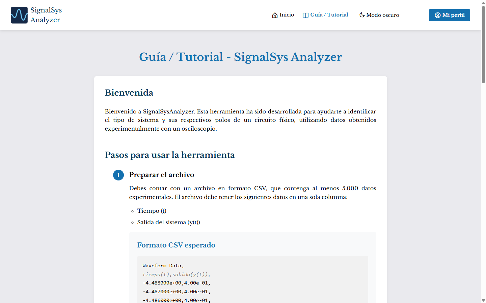

# SignalSys Analyzer

Web app that identifies control systems from CSV signal data using Go, Vue and scikit-learn.

Aplicación web para la **identificación de sistemas de control**: el usuario carga un archivo `.csv` con la respuesta al escalón de un circuito (medida con osciloscopio) y la aplicación determina si el sistema es sobreamortiguado o subamortiguado, estima sus polos y muestra la gráfica de la respuesta con un resumen técnico.



## Contenido

- [Contexto del proyecto](#contexto-del-proyecto)
- [Características](#características)
- [Capturas](#capturas)
- [Inicio rápido con Docker](#inicio-rápido-con-docker)
- [Ejecución manual (desarrollo)](#ejecución-manual-desarrollo)
- [Cómo funciona la parte de ML](#cómo-funciona-la-parte-de-ml)
- [Datos de prueba](#datos-de-prueba)
- [Arquitectura](#arquitectura)
- [Configuración y API](#configuración-y-api)
- [Estructura del repositorio](#estructura-del-repositorio)
- [Licencia](#licencia)

## Contexto del proyecto

Proyecto académico universitario. Yo desarrollé la mayor parte: backend, frontend, el servicio de ML y el entrenamiento de los modelos. Mis compañeros colaboraron aportando las muestras tomadas con el osciloscopio.

## Características

- Carga de archivos `.csv` y análisis con el voltaje de entrada indicado.
- Clasificación del tipo de sistema (sobre/subamortiguado) y estimación de polos con modelos de scikit-learn.
- Gráfica de la respuesta y resumen técnico (tiempo de subida, tiempo de establecimiento, polo dominante).
- Registro e inicio de sesión con JWT, y dashboard con estadísticas, actividad reciente e historial de documentos y análisis.
- Formularios de contacto y feedback, modo claro/oscuro y guía de uso.

## Capturas

| Dashboard | Documentos |
|---|---|
|  |  |



| Guía / Tutorial |
|---|
|  |

## Inicio rápido con Docker

Requisitos: [Docker](https://www.docker.com/) con Docker Compose. No hace falta crear archivos ni instalar PostgreSQL: el `docker-compose.yml` incluye la base de datos y las tablas se crean solas al iniciar.

```bash
git clone <url-del-repositorio>
cd signal-sys-analyzer
docker compose up --build
```

Después abre **http://localhost:3000**.

| Servicio | URL |
|---|---|
| Frontend (nginx, redirige `/api` al backend) | http://localhost:3000 |
| Backend (Go) | http://localhost:8081 |
| ML API | http://localhost:5001/health |
| PostgreSQL | interno (no se publica puerto) |

Para detenerlo: `docker compose down` (añade `-v` para borrar también la base de datos).

### Cloudinary: necesario para analizar archivos

El backend guarda los CSV en [Cloudinary](https://cloudinary.com) (hay plan gratuito). **Sin credenciales** puedes registrarte, iniciar sesión y navegar, pero subir un CSV responde con error `HTTP 500` ("faltan credenciales de Cloudinary"). Para analizar archivos crea un archivo `.env` en la raíz del proyecto, junto al `docker-compose.yml`:

```
CLOUDINARY_CLOUD_NAME=tu_cloud_name
CLOUDINARY_API_KEY=tu_api_key
CLOUDINARY_API_SECRET=tu_api_secret
```

y vuelve a ejecutar `docker compose up --build`. Ese mismo `.env` admite las demás variables opcionales (ver [Configuración y API](#configuración-y-api)).

## Ejecución manual (desarrollo)

Requisitos: [Go](https://go.dev/) 1.23+, [Node.js](https://nodejs.org/) 18+, Python 3.11 (el de la imagen Docker) y un PostgreSQL accesible. Abre tres terminales.

**1. ML API** (http://localhost:5001/health)

PowerShell:
```powershell
cd ml-api
python -m venv .venv
.venv\Scripts\Activate.ps1
pip install -r requirements.txt
python main.py
```

Linux / macOS:
```bash
cd ml-api
python3 -m venv .venv
source .venv/bin/activate
pip install -r requirements.txt
python main.py
```

**2. Backend** (http://localhost:8081). Crea `backend/.env` con la conexión a tu PostgreSQL y las credenciales de Cloudinary (variables en [Configuración y API](#configuración-y-api)):

```bash
cd backend
go run .
```

**3. Frontend** (http://localhost:3000). Crea `frontend/.env` con:

```
VITE_API_URL=http://localhost:8081/api
```

```bash
cd frontend
npm install
npm run dev
```

> Los archivos `.env` contienen credenciales y están excluidos de Git. No los subas al repositorio.

## Cómo funciona la parte de ML

El backend recorta la región útil de la señal, calcula **30 características estadísticas** y las envía a un servicio Flask. Un `RandomForestClassifier` decide si el sistema es sobre o subamortiguado y `RandomForestRegressor` específicos para cada tipo estiman los polos. Los modelos se entrenaron con **200 muestras** de circuitos RLC serie.

Es un clasificador de **dos clases** (no reconoce sistemas críticamente amortiguados ni de otro orden), y las métricas del entrenamiento no se midieron con datos independientes. Los detalles —algoritmos, características, datos, métricas reportadas y limitaciones— están en [`docs/ml.md`](docs/ml.md).

## Datos de prueba

[`docs/ejemplo.csv`](docs/ejemplo.csv) es una captura real de un circuito RLC serie sobreamortiguado con **8 V** de entrada: súbelo en la página de inicio e indica `8` como voltaje. La estructura del archivo (metadatos del osciloscopio, columnas tiempo y voltaje) se explica en [`docs/formato-csv.md`](docs/formato-csv.md).

## Arquitectura

```
┌──────────────┐   /api    ┌──────────────┐   HTTP   ┌────────────────┐
│   Frontend   │ ────────► │   Backend    │ ───────► │     ML API     │
│ Vue 3 + Vite │           │  Go + Gin    │          │ Flask+sklearn  │
│    :3000     │           │    :8081     │          │     :5001      │
└──────────────┘           └──────┬───────┘          └────────────────┘
                                  │
                   ┌──────────────┴──────────────┐
                   │ PostgreSQL (GORM)           │  Cloudinary
                   │ usuarios, documentos,       │  (archivos CSV)
                   │ análisis y resultados       │
                   └─────────────────────────────┘
```

| Carpeta | Tecnología | Descripción |
|---|---|---|
| `frontend/` | Vue 3, Vuetify, Pinia, Vite, Chart.js | Interfaz de usuario |
| `backend/` | Go, Gin, GORM, JWT | API REST, autenticación y persistencia |
| `ml-api/` | Python, Flask, scikit-learn | Predicción del tipo de sistema y de los polos |

## Configuración y API

<details>
<summary>Variables de entorno</summary>

Con Docker se definen en un `.env` en la raíz (todas son opcionales salvo Cloudinary para subir archivos); con ejecución manual, en `backend/.env`.

| Variable | Descripción |
|---|---|
| `POSTGRES_USER`, `POSTGRES_DB` | Solo Docker. Usuario y nombre de la base incluida (por defecto `postgres` / `signal_sys_analysis`). La base no publica puertos y usa autenticación `trust` dentro de la red de Docker, por lo que no se guarda ninguna contraseña en el repositorio; es una configuración solo para desarrollo local |
| `FRONTEND_PORT`, `API_PORT`, `ML_PORT` | Solo Docker. Puertos publicados (por defecto `3000`, `8081`, `5001`) |
| `DB_HOST`, `DB_PORT`, `DB_USER`, `DB_PASSWORD`, `DB_NAME` | Solo manual. Conexión a PostgreSQL (obligatorias; con Docker se configuran solas) |
| `ML_SERVICE_URL` | URL de la ML API (por defecto `http://localhost:5001`; con Docker `http://api-ml:5001`) |
| `PORT`, `ENV`, `FRONTEND_URL` | Puerto del backend, modo (`production` activa el modo release) y origen extra permitido por CORS |
| `CLOUDINARY_CLOUD_NAME`, `CLOUDINARY_API_KEY`, `CLOUDINARY_API_SECRET` | Obligatorias para subir CSV y analizarlos |
| `SMTP_HOST`, `SMTP_PORT`, `SMTP_USERNAME`, `SMTP_PASSWORD`, `EMAIL_FROM_NAME`, `EMAIL_FROM_ADDRESS`, `ADMIN_EMAIL` | Opcionales, solo para los formularios de contacto y feedback |

</details>

<details>
<summary>Endpoints del backend</summary>

Todas las rutas cuelgan de `/api`. Las autenticadas requieren `Authorization: Bearer <token>`.

| Método | Ruta | Acceso | Descripción |
|---|---|---|---|
| POST | `/register`, `/login` | Público | Registro e inicio de sesión |
| POST | `/documents` | Opcional | Subida de un documento `.csv` |
| POST | `/analysis` | Opcional | Crea una solicitud de análisis |
| GET | `/analysis/:id` | Opcional | Consulta el resultado de un análisis |
| POST | `/forms/contact`, `/forms/feedback` | Opcional | Formularios de contacto y feedback |
| GET | `/profile` | Autenticado | Perfil del usuario |
| PUT / DELETE | `/user/update`, `/user/delete` | Autenticado | Editar o eliminar la cuenta |
| GET | `/user/stats`, `/user/recent-activity`, `/user/recent-documents` | Autenticado | Datos del dashboard |
| GET / DELETE | `/user/documents`, `/user/documents/:id` | Autenticado | Documentos del usuario y su detalle |
| DELETE | `/user/documents/:id/permanent` | Autenticado | Eliminación permanente |
| GET | `/user/analysis` | Autenticado | Análisis del usuario |

La ML API expone `POST /predecir_tipo`, `POST /predecir_polos` y `GET /health`.

</details>

## Estructura del repositorio

```
signal-sys-analyzer/
├── backend/      # API en Go (handlers, middleware, models, database, utils)
├── frontend/     # SPA en Vue 3 (pages, components, stores, services)
├── ml-api/       # Servicio Flask y modelos entrenados (.pkl)
├── docs/         # ML, formato del CSV, CSV de ejemplo y capturas
└── docker-compose.yml
```

El repositorio no incluye pruebas automatizadas ni integración continua.

## Licencia

Distribuido bajo la licencia [MIT](LICENSE).
